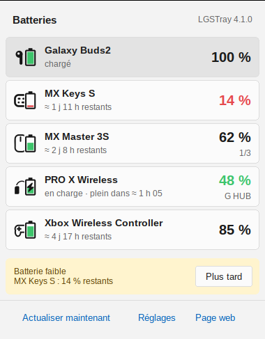
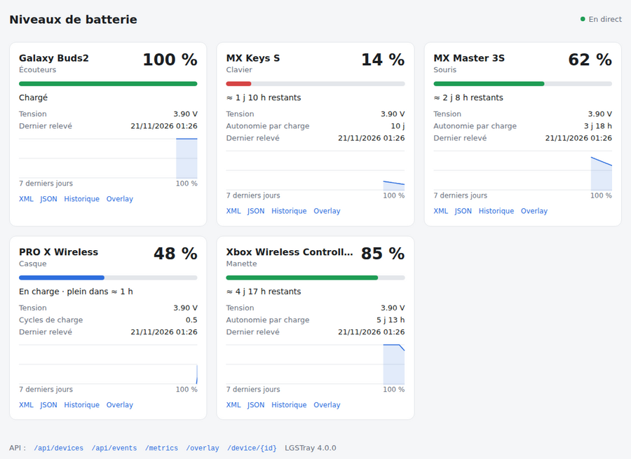
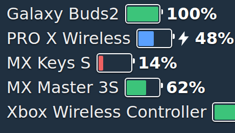
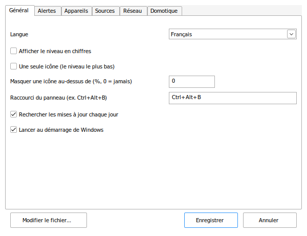

<p align="center"></p>

<h1 align="center">Batly</h1>

<p align="center"><b>Toutes vos batteries, d'un coup d'œil.</b></p>

[](https://github.com/illama/batly/actions/workflows/ci.yml)
[](https://github.com/illama/batly/releases/latest)
[](LICENSE)


Toutes les batteries de vos périphériques dans la zone de notification de Windows : souris,
claviers et casques Logitech, mais aussi écouteurs Bluetooth, manettes Xbox / PlayStation et
périphériques Razer, Corsair, SteelSeries. Avec l'autonomie restante estimée, l'historique,
des alertes intelligentes, une API et la domotique.

**[⬇ Télécharger la dernière version](https://github.com/illama/batly/releases/latest)**

<p align="center">
  
  
</p>

Réécriture complète en Rust de [LGSTrayBattery](https://github.com/andyvorld/LGSTrayBattery)
(C# / .NET 8 / WPF), compatible avec ses réglages et son API HTTP, dans un seul exécutable
natif d'environ 1,5 Mo, sans runtime .NET, sans `hidapi.dll`, sans processus auxiliaire.

> **État** : le code compile pour Windows x64 et la logique portable (protocoles HID++,
> Razer / SteelSeries / Corsair / PlayStation, historique et estimations, alertes, réglages,
> API, MQTT…) est couverte par des tests automatisés. L'interface (panneau, réglages, menu,
> alertes) et l'API ont été vérifiées sous Wine avec des périphériques simulés (`--demo`).
> L'accès au **vrai matériel** n'a pas encore été essayé : en cas de souci, lancez
> `batly.exe --debug` ou utilisez *Signaler un problème* dans le menu.

> **Anciennement LGSTray.** Batly 5 est une nouvelle application : elle ne reprend ni les
> réglages ni l'historique de LGSTray 4.x et ne le met pas à jour. Désinstallez LGSTray
> (Paramètres Windows → Applications) avant d'installer Batly, sinon les deux tourneront.

## Installation

| Fichier | Usage |
|---|---|
| `Batly-Setup-<version>.exe` | Installateur par utilisateur (aucun droit administrateur). `/S` pour une installation silencieuse. |
| `Batly-<version>-portable.zip` | Version portable : décompresser et lancer `batly.exe` (les réglages restent dans le dossier). |

Également prévu pour `winget install illama.Batly`, Scoop et Chocolatey
(manifestes dans [`packaging/`](packaging/README.md)).

L'appli se met à jour toute seule depuis les releases GitHub (vérification une fois par jour,
installateur vérifié par SHA-256 avant d'être lancé). Windows 10 (1607) ou plus récent, x64.

## Ce que fait Batly

### Le panneau des batteries
**Clic gauche** sur l'icône (ou **Ctrl+Alt+B**, réglable) : un panneau façon Windows 11 avec
tous les périphériques, leur niveau, leur état, **l'autonomie restante** (« ≈ 2 j 8 h
restants ») ou le **temps de charge** (« plein dans ≈ 40 min »), le canal Easy-Switch,
l'ordinateur d'origine pour les appareils d'un autre PC, et l'alerte en cours avec son bouton
*Plus tard*. **Clic droit** : le menu.

### Les icônes
- une icône par périphérique choisi, ou **une seule icône** qui montre le niveau le plus bas ;
- jauge colorée ou pourcentage, selon le type de périphérique, le thème clair/sombre, le DPI ;
- **masquage automatique** d'une icône tant que le niveau est au-dessus de X % ;
- **noms personnalisés** (« Souris bureau »), choix de l'icône et de l'ordre.

### Les alertes intelligentes
- **« Pensez à la recharger »** : prévient quand l'autonomie estimée passe sous 24 h (réglable),
  avant même le seuil de batterie faible ;
- batterie faible (seuil global ou **par appareil**, appareil muet possible) ;
- **charge à 80 %** (réglable) pour préserver la batterie, et **charge terminée** ;
- appareil **hors ligne** depuis X heures (pile vide ? souris oubliée ?) ;
- **discrètes pendant les jeux en plein écran et en Ne pas déranger** : elles attendent la fin ;
- **Me le rappeler plus tard** (4 h par défaut) depuis le panneau ou le menu.

### L'historique
Chaque relevé est enregistré (`history\` à côté des réglages, conservé 2 ans) et donne :
l'autonomie restante et le temps de charge, **l'autonomie d'une charge complète**, la durée
moyenne d'une charge, le **nombre de cycles** et, après deux mois, **l'usure de la batterie**
(autonomie actuelle comparée aux premières semaines, tension à pleine charge).

### Tous les périphériques
| Source | Ce qui est lu |
|---|---|
| Logitech HID++ (Unifying, Bolt, Lightspeed, Bluetooth, câble) | niveau, charge, tension, firmware, canal Easy-Switch, récepteur |
| Logitech G HUB | niveau et autonomie estimée par G HUB |
| Bluetooth | tout appareil qui donne sa batterie à Windows (écouteurs, casques, claviers…) ; Bluetooth LE par notifications GATT |
| Manettes | Xbox (XInput), DualSense, DualSense Edge, DualShock 4 (USB et Bluetooth) |
| Razer | souris et claviers sans fil (protocole openrazer) |
| SteelSeries | casques Arctis 1 / 7 / 7X / 7P / Pro Wireless / Nova 7 |
| Corsair | casques Void / Void Pro / Void Elite / HS70 sans fil |
| Autres PC | les périphériques d'un autre ordinateur où tourne Batly (voir *Plusieurs PC*) |

Toutes ces sources se désactivent une à une dans les réglages. Les lectures n'envoient jamais
de commande qui modifie la configuration d'un périphérique.

### Récepteurs Logitech
*Récepteurs et appareils…* dans le menu : appairer et désappairer un appareil sur un récepteur
**Unifying** ou **Bolt** (avec le code d'authentification Bolt), voir le firmware, le canal
Easy-Switch, et régler le **DPI**, le taux de rapport, le **rétroéclairage** et **SmartShift**
— sans Logi Options+ ni le logiciel Unifying abandonné.

### Éclairage RGB (expérimental, 5.1)
Dans la même fenêtre, section **Éclairage** : zone (principale, logo…), effet (couleur fixe,
respiration, cycle de couleurs, éteint), couleur et vitesse, pour les appareils Logitech
LIGHTSYNC (HID++ 0x8070 / 0x8071).
- **Aperçu** : Batly pilote les LEDs tout de suite ; **Rendre la main** (ou fermer la fenêtre)
  les rend à l'appareil.
- **Enregistrer dans l'appareil** : écrit l'éclairage dans le **profil actif de la mémoire
  embarquée** (comme le gestionnaire de mémoire de G HUB) ; l'appareil le garde sans logiciel.
  Souris uniquement pour l'instant. Avant toute écriture, la mémoire est vérifiée (taille,
  CRC, format) puis **sauvegardée** dans `%APPDATA%\Batly\backups\` ; après l'écriture elle est
  relue, et restaurée si elle ne correspond pas. Un profil d'usine ou un format inconnu n'est
  jamais modifié.
- **Diagnostic** : rapport en lecture seule (zones, effets, mémoire) pour aider à prendre en
  charge un appareil.

### Plusieurs PC
Une souris Easy-Switch passe d'un PC à l'autre ? Ajoutez l'autre PC dans *Réglages → Réseau →
Autres PC* (`http://pc-salon:12321`) : ses périphériques apparaissent ici aussi, avec **leur
dernier état connu** quand il est éteint. Ouvrir l'API au réseau (`0.0.0.0`) se protège par un
**jeton** (bouton *Nouveau* dans les réglages), exigé de tout autre ordinateur.

### Domotique et intégrations
- **MQTT avec découverte Home Assistant** : chaque périphérique devient un appareil avec ses
  capteurs (batterie, charge, tension, autonomie restante) ;
- **webhooks** à chaque alerte (format Discord et Slack reconnu, JSON pour le reste) ;
- **Prometheus** (`/metrics`), flux **en direct** (`/api/events`) ;
- **overlay OBS** (`/overlay`, ci-dessous), **plugin Stream Deck** et **skin Rainmeter** : voir
  [`integrations/`](integrations/README.md).



### Le reste


- **Réglages** dans une vraie fenêtre (onglets Général, Alertes, Appareils, Sources, Réseau,
  Domotique) ; le fichier TOML reste modifiable et **s'applique dès l'enregistrement** ;
- interface en **français, anglais, allemand, espagnol, italien et portugais** ;
- **Signaler un problème** : prépare un zip (journal, réglages **sans les secrets**, liste des
  périphériques) et ouvre une issue GitHub préremplie ;
- en ligne de commande :

```bat
batly.exe --status           :: état des périphériques de l'instance lancée
batly.exe --status --json    :: pareil, en JSON (scripts)
batly.exe --panel            :: ouvre le panneau
batly.exe --settings         :: ouvre les réglages
batly.exe --debug            :: écrit batly.log à côté des réglages
batly.exe --demo             :: périphériques fictifs (essais, captures)
```

## Ce qui change par rapport à l'original

| | LGSTrayBattery 3.0.3 (C#) | Batly (Rust) |
|---|---|---|
| Distribution | zip avec .NET 8 embarqué, ou .NET 8 à installer | installateur ~2 Mo / exe ~1,5 Mo, aucune dépendance, mise à jour automatique |
| Processus | 2 (interface + `LGSTrayHID`), IPC MessagePack | 1 |
| Accès HID | `hidapi.dll` via P/Invoke | API Windows directes, E/S asynchrones (overlapped) |
| Attente | lectures avec délai de 100 ms en boucle | événementiel pour Logitech ; un réveil toutes les 10 min pour les alertes, une lecture par minute pour les autres marques (désactivables) |
| Découverte des fonctions | parcours de toute la table HID++ du périphérique | 5 requêtes ciblées |
| Changement d'état (branchement du câble…) | visible au prochain sondage (jusqu'à 10 min) | immédiat (événements batterie HID++) |
| Périphérique en veille | ré-interrogé toutes les 10 s | notifications du récepteur + attente progressive |
| Bluetooth LE / interface « longue » seule | non géré | géré |
| Jauge | 4 paliers | continue, colorée (vert / orange / rouge) |
| Affichage numérique | « 100 » tronqué, pas d'état de charge | taille ajustée, couleur selon l'état |
| Alertes | — | batterie faible, prédictive, limite de charge, charge terminée, hors ligne, plus tard |
| Thème | surveillance WMI | message système, sans WMI |
| Explorer redémarré | — | icônes recréées automatiquement |
| Sortie de veille du PC | — | relecture automatique |
| Serveur HTTP | HTTP.sys (droits admin pour `0.0.0.0`), pas d'échappement XML | sockets standards, XML échappé, **+ JSON** |
| Identifiant de secours | `GetHashCode()` (change à chaque lancement) | hachage stable |
| Réglages | `appsettings.toml` + `user.config` .NET | un seul `appsettings.toml`, écriture atomique |
| Installation | — | installateur + désinstallateur |

## Réglages

Tout se règle dans *Réglages…* (menu ou panneau). Le fichier reste
`%APPDATA%\Batly\appsettings.toml` (ou à côté de l'exécutable en mode portable), commenté
section par section ([modèle complet](packaging/appsettings.toml)) ; il est relu **dès qu'il
est enregistré**. Si le changement touche le serveur web, MQTT ou les sources, Batly se
relance tout seul. Le fichier de l'original est accepté tel quel.

| Section | Contenu |
|---|---|
| `[UI]` | chiffres ou jauge, icônes affichées, seuil de batterie faible, langue, icône unique, masquage au-dessus de X %, raccourci, ordre |
| `[Alerts]` | alerte prédictive et son horizon, limite de charge, fin de charge, hors ligne, discrétion, délai de rappel |
| `[History]` | historique et durée de conservation |
| `[HTTPServer]` | page web / API, adresse, port, jeton, autres PC (`peers`) |
| `[GHub]`, `[Native]` | sources Logitech (comme l'original) |
| `[OtherDevices]` | Bluetooth, manettes, Razer, Corsair, SteelSeries |
| `[MQTT]`, `[Webhooks]` | domotique |
| `[Updates]` | vérification quotidienne, version ignorée |
| `[Devices."<id>"]` | par appareil : nom affiché, icône, seuil, muet |

## API HTTP

La page `http://localhost:12321/` montre tous les périphériques en direct (cartes, autonomie,
santé, cycles, courbe des 7 derniers jours), en clair ou sombre.

| Route | Réponse |
|---|---|
| `GET /` ou `/devices` | page web en direct |
| `GET /device/{id ou nom}` | XML, mêmes balises que l'original (+ `status`, `online`, `source`) |
| `GET /api/devices` | tableau JSON |
| `GET /api/device/{id ou nom}` | objet JSON (+ `alias`, `time_left_hours`, `time_to_full_hours`, `health_percent`, `cycles`, `host`) |
| `GET /api/events` | flux en direct (Server-Sent Events) |
| `GET /api/history/{id}?days=7` | relevés et statistiques |
| `GET /metrics` | Prometheus |
| `GET /overlay` | overlay OBS |

```xml
<xml><device_id>…</device_id><device_name>G Pro Wireless</device_name><device_type>Mouse</device_type>
<battery_percent>69.00</battery_percent><battery_voltage>3.92</battery_voltage><mileage>-1.00</mileage>
<charging>False</charging><last_update>2026-11-21T09:04:05Z</last_update>
<status>discharging</status><online>True</online><source>native</source></xml>
```

Différence volontaire avec l'original : `last_update` est en ISO 8601 UTC. Détails des
intégrations et de l'overlay : [`integrations/README.md`](integrations/README.md).

## Compilation

```sh
# Linux / macOS / WSL : rustup + zig + cargo-zigbuild
rustup target add x86_64-pc-windows-gnu
./build.sh            # tests, puis dist/Batly-Setup-<v>.exe, dist/Batly-<v>-portable.zip,
                      # SHA256SUMS.txt et les manifestes winget / Scoop / Chocolatey
```

Sous Windows (toolchain MSVC) : `cargo build --release -p batly`, puis
`set BATLY_PAYLOAD=<chemin de batly.exe>` et `cargo build --release -p batly-setup`.
`cargo test -p batly` fonctionne sur n'importe quel système.

Une release se fait en poussant un tag `v<version>` : le workflow
[`release.yml`](.github/workflows/release.yml) compile, signe (si SignPath est configuré, voir
[SIGNING.md](SIGNING.md)), publie directement la release (préversion pour un tag `v…-…`) et prépare les paquets.

## Organisation du code

```
app/src/
  main.rs         démarrage, ligne de commande, branchement des services
  model.rs        registre des périphériques partagé (événements, abonnés)
  config.rs       réglages TOML
  i18n.rs         textes en 6 langues
  hidpp.rs        moteur HID++ 1.0/2.0 (batterie, infos, appairage, réglages), testé avec un périphérique simulé
  native.rs       Windows : énumération HID, E/S overlapped, un fil par récepteur
  receivers.rs    fenêtre « Récepteurs et appareils » (dont l'éclairage)
  lighting.rs     effets LED, profils embarqués (CRC, vérifications), sans E/S
  ghub.rs         client WebSocket de Logitech G HUB
  bluetooth.rs    batterie Bluetooth classique et LE (GATT)
  gamepad.rs      manettes XInput, DualSense, DualShock 4
  vendors.rs      Razer, SteelSeries, Corsair
  hidio.rs        accès HID générique · tracker.rs : relevés → événements
  history.rs      historique et statistiques (autonomie, charge, cycles, usure)
  alerts.rs       moteur d'alertes · notice.rs : type d'alerte
  tray.rs         icônes, menu, alertes, rechargement des réglages, boucle de messages
  panel.rs        panneau des batteries · settings_ui.rs : fenêtre de réglages · ui.rs : dessin
  hotkey.rs       raccourci clavier global
  http.rs         page web, API, SSE, Prometheus, overlay
  peers.rs        autres instances Batly du réseau
  mqtt.rs         client MQTT + découverte Home Assistant · webhooks.rs : webhooks
  fetch.rs        requêtes HTTP(S) sortantes (WinHTTP)
  update.rs       mises à jour · sha256.rs · report.rs : « Signaler un problème » · actions.rs : menus associés
  icon.rs         rendu des icônes (RGBA)
  uninstall.rs    désinstallation
setup/            installateur (embarque batly.exe, gère /S et /update)
integrations/     overlay OBS, plugin Stream Deck, skin Rainmeter
packaging/        winget, Scoop, Chocolatey
build/            script de ressources partagé (icône, version, manifeste)
```

## Licence et remerciements

GPL-3.0, comme le projet d'origine d'[andyvorld](https://github.com/andyvorld/LGSTrayBattery),
dont proviennent le fonctionnement général, la table tension → pourcentage et les pictogrammes.
Protocole HID++ d'après [Solaar](https://github.com/pwr-Solaar/Solaar). Pictogrammes : The Noun Project
(souris : projecthayat ; clavier : HideMaru ; casque : Peter Lakenbrink).
